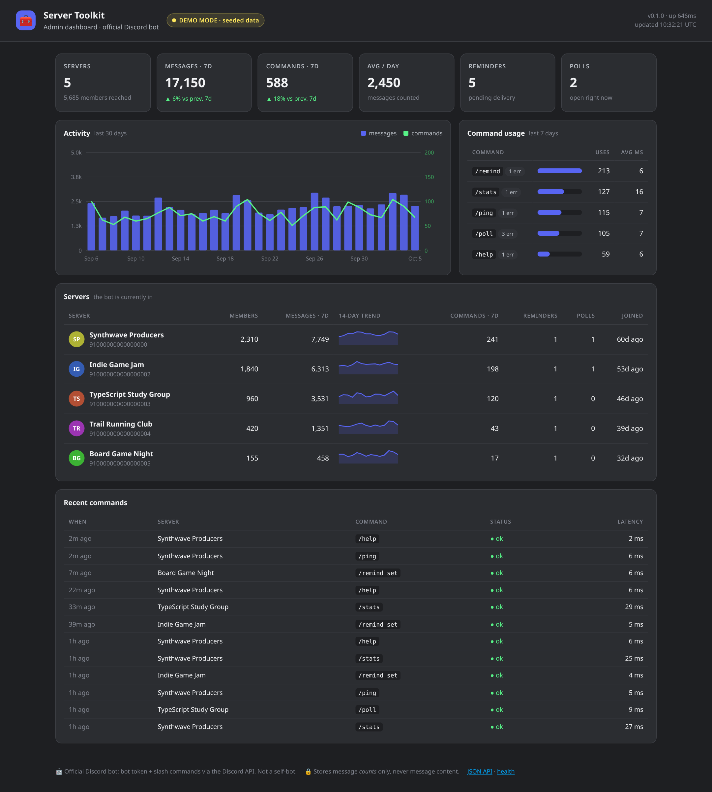
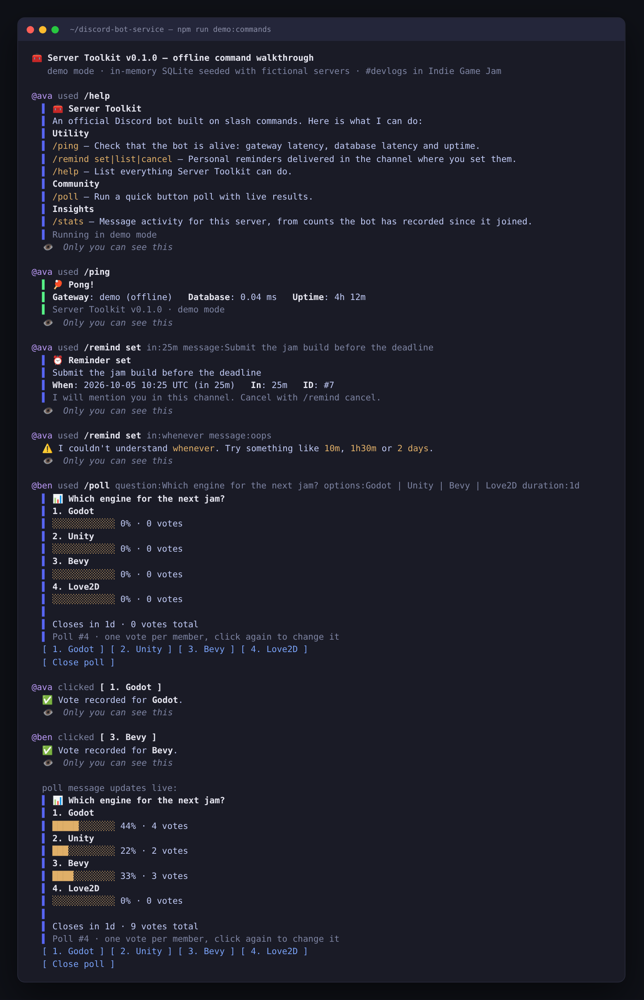
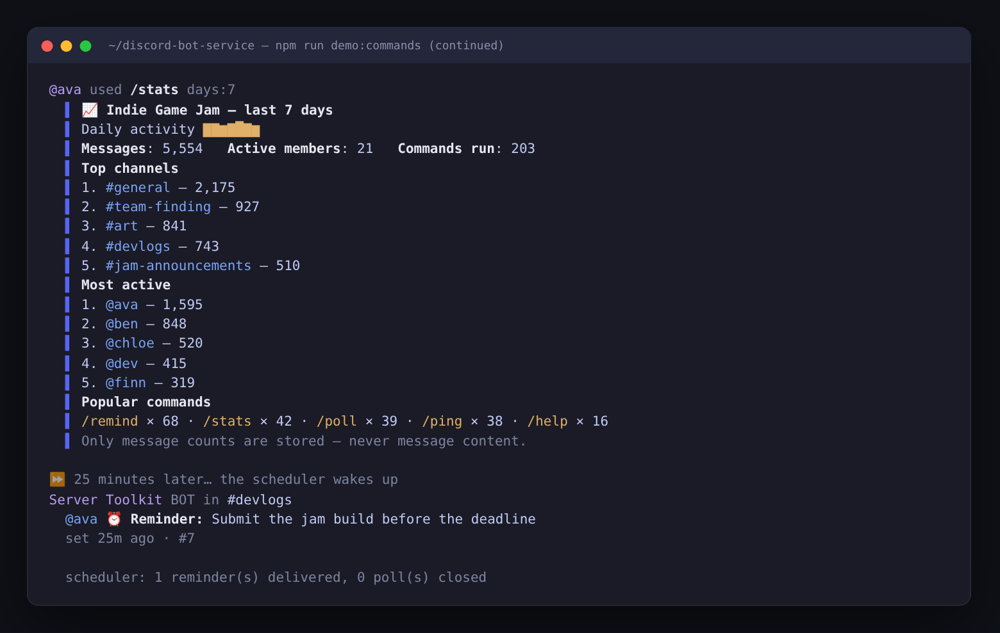
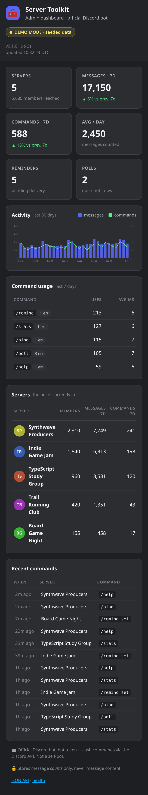
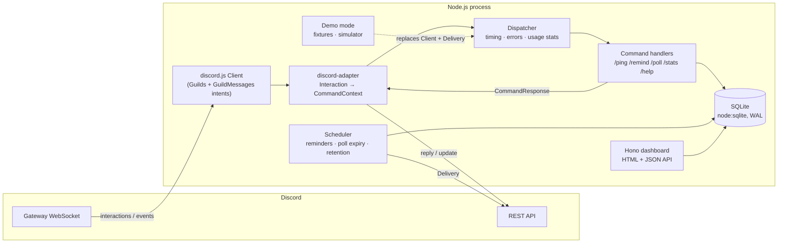

# Server Toolkit: Discord bot as a service

[](https://github.com/PrimeGoose/discord-bot-service/actions/workflows/ci.yml)


[](LICENSE)

A production-shaped Discord bot built with **TypeScript + discord.js v14**. It has slash commands, SQLite persistence, a background scheduler, structured logs, graceful shutdown and a small **admin dashboard**. A **demo mode** runs the whole thing (dashboard included) **without a Discord token**, using seeded fixture data.

> [!IMPORTANT]
> **This is an official Discord bot, not a self-bot.** It logs in with a bot token from the [Discord Developer Portal](https://discord.com/developers/applications), talks to Discord only through the public Gateway and REST APIs, and interacts with users only through slash commands and buttons. It never uses a user-account token, never automates a user account, and never reads message content: it asks for no privileged intents and stores message **counts** only.



<table>
<tr>
<td width="50%"></td>
<td width="50%"><br></td>
</tr>
</table>

<sub>Every screenshot comes from demo mode with fictional servers and members. `npm run screenshots` regenerates them.</sub>

---

## Quick start (demo mode, no token)

Requires **Node.js ≥ 22.13** (it uses the built-in `node:sqlite`).

```bash
npm ci
npm run demo            # bot runtime + dashboard on http://127.0.0.1:3000 with seeded data
npm run demo:commands   # offline walkthrough of every slash command in your terminal
```

Or with Docker:

```bash
docker compose up --build   # DEMO_MODE defaults to true → http://localhost:3000
```

Demo mode runs the real dispatcher, command handlers, SQLite store, scheduler and dashboard. Only the Discord transport is swapped out: fixtures stand in for the gateway, and a small simulator adds activity every few seconds so the dashboard updates on screen.

## Commands

| Command | What it does |
| --- | --- |
| `/ping` | Gateway heartbeat, database round-trip and uptime (ephemeral). |
| `/remind set in:<duration> message:<text>` | Personal reminder delivered in the same channel, e.g. `in:1h30m`. Survives restarts. |
| `/remind list` · `/remind cancel id:<n>` | Your pending reminders; you can only cancel your own. |
| `/poll question:<q> options:"A \| B \| C" [duration:1d]` | Button poll with live bars, one vote per member (click again to change it). Only the author can close it early, and it closes on its own when the duration runs out. |
| `/stats [days:1-30]` | Server activity from counts the bot recorded itself: messages, active members, top channels and members, a daily sparkline, popular commands. |
| `/help` | Generated from the command registry, so it always matches the real commands. |

Guardrails: durations from 10 s to 365 days, at most 25 pending reminders per user, 2–5 poll options of up to 80 characters each. Bot output never pings `@everyone`, `@here` or roles (`allowedMentions.parse = []`); only a reminder's owner gets mentioned.

## Running it for real

1. Create an application in the [Discord Developer Portal](https://discord.com/developers/applications), add a **Bot** and copy its token. You don't need any privileged intents, so leave *Message Content*, *Server Members* and *Presence* off.
2. Copy the config and fill it in:
   ```bash
   cp .env.example .env    # set DEMO_MODE=false, DISCORD_TOKEN, DISCORD_CLIENT_ID
   ```
3. Invite the bot. The scopes are `bot` and `applications.commands`; the permissions are View Channels, Send Messages and Embed Links (`19456`):
   `https://discord.com/oauth2/authorize?client_id=<DISCORD_CLIENT_ID>&scope=bot+applications.commands&permissions=19456`
4. Register the slash commands, then start the bot:
   ```bash
   npm run register -- --guild   # instant, only DISCORD_DEV_GUILD_ID (development)
   npm run register              # global
   npm run build && npm start
   ```
   With Docker: `docker compose up -d --build`, then `docker compose run --rm bot node dist/scripts/register-commands.js`.

`npm run register -- --dry-run` prints the exact JSON payload without contacting Discord.

### Configuration

All configuration comes from environment variables (or a local `.env`). It is validated with zod at startup, and a bad value stops the process with a clear message.

| Variable | Default | Notes |
| --- | --- | --- |
| `DEMO_MODE` | `false` (`true` in Compose) | No Discord connection; in-memory SQLite seeded with fixtures. |
| `DISCORD_TOKEN` / `DISCORD_CLIENT_ID` | none | Required when `DEMO_MODE=false`. Bot token only. |
| `DISCORD_DEV_GUILD_ID` | none | Target for `npm run register -- --guild`. |
| `DATABASE_PATH` | `./data/toolkit.db` | `/data/toolkit.db` (a volume) in Docker. |
| `DASHBOARD_ENABLED` / `DASHBOARD_HOST` / `DASHBOARD_PORT` | `true` / `127.0.0.1` / `3000` | The dashboard binds to localhost by default. |
| `DASHBOARD_PASSWORD` | none | Turns on HTTP Basic auth (`admin` / password) for everything except `/healthz`. |
| `SCHEDULER_INTERVAL_MS` | `15000` | How often due reminders and expired polls are checked. |
| `LOG_LEVEL` / `LOG_FORMAT` | `info` / `pretty` | `json` in containers. |

## Architecture



```
src/
  index.ts              entrypoint: config → store → (Discord client | demo) → scheduler → dashboard; shutdown hooks
  config.ts             zod-validated env config (demo vs live requirements)
  logger.ts             pino, JSON in prod, pretty in dev, token redaction
  commands/             one file per command + Dispatcher + transport-agnostic types
  bot/                  discord.js client wiring, Interaction ⇄ CommandContext adapter, Scheduler
  db/                   node:sqlite wrapper, forward-only migrations, repositories (guilds, reminders, polls, stats)
  dashboard/            Hono app, server-rendered HTML, dependency-free SVG charts
  demo/                 fixtures, deterministic seed, activity simulator, terminal renderer + walkthrough
  scripts/              register-commands (REST bulk overwrite, --guild, --dry-run)
test/                   Vitest: DB, commands, buttons, scheduler, gateway wiring, dashboard, config, rendering
```

**Request flow.** The client receives an interaction. The adapter turns it into a plain `CommandContext` (user, guild, typed option getters, store, clock, logger). The `Dispatcher` runs the handler, times it, writes a `command_usage` row and turns exceptions into friendly ephemeral replies. Handlers return a `CommandResponse` built with discord.js builders. The adapter maps that to `reply`, `update` or `followUp` and forces safe `allowedMentions`.

**Data model.** The tables are `guilds`, `reminders`, `polls`, `poll_votes` (primary key `(poll_id, user_id)`, which enforces one vote per member), `message_counts` (per guild, channel, user and UTC day, holding a counter and nothing else) and `command_usage`. Migrations run in a transaction and are recorded in `schema_migrations`.

## Decisions

- **Handlers don't know about discord.js interactions.** They receive a small `CommandContext` and return builders. Unit tests, the demo and the terminal walkthrough all call the same code as production, with no gateway mocks.
- **`node:sqlite` instead of `better-sqlite3`.** It ships with Node 22, so there's no native add-on, no `node-gyp` in Docker and no prebuild mismatches in CI. The cost is an "experimental" label (silenced with `--disable-warning=ExperimentalWarning`). Everything sits behind a thin `Database` wrapper with cached statements, savepoint-based nested transactions and strict named parameters (a typo throws instead of binding `NULL`).
- **The scheduler polls the database instead of keeping one timer per reminder.** Restarts and crashes lose nothing, because anything that came due while the bot was down goes out on the first tick. Ticks never overlap. A failed delivery is retried and abandoned after 24 h (deleted channel, DMs closed). Reminders fall back to a DM if the channel is gone.
- **Button polls instead of Discord's native polls.** The votes live in our database, so `/stats`, the dashboard and the "change your vote" behaviour all work from data we own. Button `customId`s (`poll:vote:<id>:<option>`) are stateless, so polls keep working across restarts.
- **Minimal, non-privileged intents.** `Guilds` + `GuildMessages` are enough to count messages. Without the privileged Message Content intent Discord doesn't send the text, and the bot neither needs nor stores it. Counters are pruned after 90 days.
- **One process, server-rendered dashboard.** Hono with tagged-template HTML (auto-escaped), a nonce-based CSP and SVG charts drawn by hand. That means no front-end build, no extra container and no CORS. The dashboard is read-only, shows no member IDs and binds to localhost unless you say otherwise. Splitting bot and dashboard into two processes would mean moving SQLite to a networked database first.
- **Demo mode is a runtime mode, not a mock layer.** It uses an in-memory database seeded with a deterministic PRNG (screenshots are reproducible), uses a logging `Delivery` instead of the Discord API, and never constructs a discord.js client.

## Testing & quality

```bash
npm run check   # eslint (strict type-checked) → tsc --noEmit → vitest → build → demo smoke test
```

- **Over 90 Vitest tests** cover duration parsing, config validation, migrations, transactions and rollbacks, every repository, every command (happy paths and validation), poll voting and closing via buttons, dispatcher error handling, scheduler retries and no-overlap, gateway event wiring with a fake client, the DM fallback, the dashboard (CSP nonce, XSS escaping, basic auth, no member IDs in the HTML) and graceful shutdown ordering. Coverage is about 88% of statements (`npm run test:coverage`).
- **The smoke test** (`npm run smoke`) boots the compiled app in demo mode, probes `/healthz`, `/api/summary` and `/`, sends `SIGTERM` and asserts a clean exit with code 0.
- **CI** (GitHub Actions) runs lint, typecheck, tests with coverage, build, the smoke test and a `register --dry-run` on Node 22 and 24, then a gitleaks secret scan and a Docker build that starts the image in demo mode and checks its health endpoint. CI never sees a Discord token.

## Operations

- **Graceful shutdown.** On `SIGINT`/`SIGTERM` the bot stops the simulator and scheduler (waiting for an in-flight tick), closes the HTTP server, destroys the Discord client and closes SQLite. A 10 s hard timeout covers anything that hangs. `stop_grace_period` in Compose leaves room for this.
- **Structured logs.** pino JSON in production, with fields such as command, subcommand, guildId, durationMs and success, and tokens and auth headers redacted.
- **Health.** `GET /healthz` returns the mode, gateway state, uptime and version, and the Docker `HEALTHCHECK` uses it.
- **Container.** Multi-stage build on `node:22-alpine`, running as a non-root user with SQLite on a `/data` volume.

## Limitations / next steps

- A single process uses a single gateway connection, which is fine up to roughly 2,500 servers. Past that you'd need discord.js sharding (`ShardingManager`) and a shared database such as Postgres.
- The dashboard is read-only with Basic auth. A multi-tenant "bot as a service" would replace that with Discord OAuth2 login and show each user only the servers they manage.
- Reminders are delivered at most `SCHEDULER_INTERVAL_MS` late. That's acceptable for reminders; a precise-timer variant would sit on top of the same table.

## How this was built

This project was built with an agentic AI workflow under human review. I wrote the spec: the command set, the safety rules (official bot only, no message content, no mass mentions) and what "done" means. AI coding agents implemented it in small, committed steps, and I reviewed the diffs and made the design calls. Automated checks gated every change: strict type-checked ESLint, `tsc --noEmit`, Vitest, the demo smoke test and the Docker build, all of which also run in CI. The screenshots come from `scripts/screenshots.mjs` against demo mode.

## License

[MIT](LICENSE) © Kaspars Bergs. All servers, channels and members in the demo are fictional.
